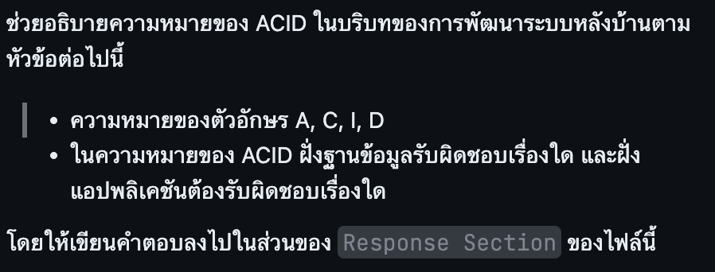

## Question

## Response Section
### ความหมายของ ACID

ACID คือคุณสมบัติ 4 ข้อที่ทำให้ธุรกรรม (transaction) ในฐานข้อมูลเชื่อถือได้ ยกตัวอย่างการโอนเงินจากบัญชี A ไปบัญชี B

- **A – Atomicity:** ทำครบทุกขั้นตอนหรือไม่ทำเลย ถ้าพังกลางทางต้อง rollback เช่น หักเงินบัญชี A แล้วระบบล่มก่อนเพิ่มเงินบัญชี B ต้องย้อนกลับ ไม่ให้เงินหายไประหว่างทาง
- **C – Consistency:** ข้อมูลต้องเปลี่ยนจากสถานะที่ถูกต้องไปสถานะที่ถูกต้องเสมอ ฐานข้อมูลบังคับให้ผ่านกฎที่ประกาศไว้ เช่น Primary Key, Foreign Key, Unique, Check เช่น ยอดเงินห้ามติดลบ
- **I – Isolation:** ธุรกรรมที่ทำพร้อมกันต้องไม่ทำให้ผลของกันและกันผิดเพี้ยน โดยเลือกระดับความเข้มงวดได้ด้วย isolation level (Read Committed, Repeatable Read, Serializable) ยิ่งเข้มยิ่งปลอดภัยแต่ช้าลง เช่น คำสั่งตัดสต็อก 2 รายการพร้อมกันต้องไม่ทำให้สต็อกคำนวณผิด
- **D – Durability:** เมื่อ commit แล้ว ข้อมูลต้องไม่หายแม้ระบบล่มหรือไฟดับ

### ความรับผิดชอบของฝั่ง Database

ฝั่ง Database รับผิดชอบกลไกที่ทำให้ ACID เกิดขึ้นจริง ได้แก่
- rollback และ transaction log เพื่อให้ได้ Atomicity และ Durability
- lock และ MVCC เพื่อให้ได้ Isolation
- การบังคับใช้ constraint ที่ประกาศไว้ เพื่อให้ได้ Consistency

### ความรับผิดชอบของฝั่ง Application

ฝั่งแอปพลิเคชันต้องรับผิดชอบ
- กำหนดขอบเขต transaction ให้ถูก (ให้คำสั่งที่ต้องสำเร็จพร้อมกันอยู่ใน transaction เดียวกัน)
- กฎทางธุรกิจที่ฐานข้อมูลไม่รู้ เช่น เงื่อนไขที่ข้ามหลายตาราง
- เลือก isolation level ให้เหมาะกับงาน เช่น ใช้ Repeatable Read ป้องกัน Non-Repeatable Read หรือใช้ `SELECT ... FOR UPDATE` ล็อกแถวที่จะแก้
- จัดการ error, retry และ deadlock เมื่อธุรกรรมล้มเหลว
