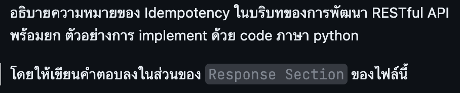

## Question

## Response Section
### Idempotency คืออะไร

Idempotency คือคุณสมบัติที่ส่ง request เดิมซ้ำกี่ครั้งก็ตาม **สถานะของระบบ** หลังจากนั้นเท่ากับส่งครั้งเดียว ไม่ได้แปลว่า response ต้องเหมือนเดิมทุกครั้ง เช่น DELETE ครั้งแรกได้ 204 ครั้งที่สองได้ 404 แต่สถานะระบบเหมือนกัน คือข้อมูลถูกลบแล้ว จึงยังนับว่า idempotent

### ทำไมต้องมีใน RESTful API

เครือข่ายไม่น่าเชื่อถือ client จึงมักต้อง retry เมื่อ timeout หรือไม่ได้รับ response ทั้งที่ server อาจประมวลผลสำเร็จไปแล้ว ถ้าไม่ออกแบบให้ idempotent จะเกิดข้อมูลซ้ำหรือตัดเงินซ้ำ เช่น ลูกค้ากด "ชำระเงิน" ซ้ำเพราะเน็ตช้า

### HTTP method

- **Idempotent ตามนิยาม:** GET, PUT, DELETE (รวม HEAD, OPTIONS)
- **ไม่ idempotent:** POST เพราะส่งซ้ำแล้วสร้างข้อมูลใหม่ทุกครั้ง จึงต้องออกแบบเพิ่ม
- **ไม่รับประกัน:** PATCH ขึ้นกับเนื้อหา เช่น `{"name": "x"}` เป็น idempotent แต่ `{"op": "increment"}` ไม่ใช่

### แนวทาง implement สำหรับ POST

1. client สร้างค่า unique (เช่น UUID) ส่งมาใน header `Idempotency-Key`
2. server "จอง" key แบบ atomic ด้วย unique constraint ของฐานข้อมูล โดย key ต้อง unique **ต่อ user** ไม่ใช่ทั้งระบบ
3. ถ้า key ซ้ำและ payload เหมือนเดิม ส่งผลลัพธ์เดิมกลับ ไม่ประมวลผลใหม่
4. ถ้า key ซ้ำแต่ payload ต่างกัน ตอบ error (422)
5. ตั้งอายุให้ key (TTL) แล้วลบทิ้งเมื่อหมดอายุ

### ตัวอย่างโค้ด Python (Django REST Framework)

```python
import hashlib
import json

from django.conf import settings
from django.db import IntegrityError, models, transaction
from rest_framework.permissions import IsAuthenticated
from rest_framework.response import Response
from rest_framework.views import APIView


class IdempotencyKey(models.Model):
    user = models.ForeignKey(settings.AUTH_USER_MODEL, on_delete=models.CASCADE)
    key = models.CharField(max_length=64)
    request_hash = models.CharField(max_length=64)
    response_body = models.JSONField(null=True)
    status_code = models.PositiveSmallIntegerField(null=True)
    created_at = models.DateTimeField(auto_now_add=True)

    class Meta:
        # Unique per user: one user can never read another user's saved response
        constraints = [
            models.UniqueConstraint(fields=["user", "key"], name="uniq_user_idem_key")
        ]


class PaymentView(APIView):
    permission_classes = [IsAuthenticated]

    def post(self, request):
        key = request.headers.get("Idempotency-Key")
        if not key:
            return Response({"detail": "Idempotency-Key header is required"}, status=400)

        # Fingerprint of the payload, to detect the same key sent with a different body
        body_hash = hashlib.sha256(
            json.dumps(request.data, sort_keys=True).encode()
        ).hexdigest()

        try:
            # Claim the key and do the work in ONE transaction:
            # if the work fails, the claim is rolled back and the client can retry
            with transaction.atomic():
                record = IdempotencyKey.objects.create(
                    user=request.user, key=key, request_hash=body_hash
                )
                result = create_payment(request.data)  # real work, returns a dict
                record.response_body, record.status_code = result, 201
                record.save()
            return Response(result, status=201)
        except IntegrityError:
            record = IdempotencyKey.objects.filter(user=request.user, key=key).first()
            if record is None:
                raise  # the error came from somewhere else, not from the key
            if record.request_hash != body_hash:
                return Response({"detail": "Key was used with a different payload"}, status=422)
            # Duplicate request: replay the saved response, do not charge again
            return Response(record.response_body, status=record.status_code)
```

### ข้อควรระวัง

- **Race condition:** อย่าเช็กด้วย `if not exists` แล้วค่อย insert เพราะ 2 request ที่มาพร้อมกันอาจผ่านทั้งคู่ ต้องใช้ unique constraint ให้ฐานข้อมูลเป็นผู้ตัดสิน request ที่สองจะรอ lock ของ unique index จนกว่า request แรก commit แล้วได้ `IntegrityError` จึงไปอ่าน response ที่ request แรกบันทึกไว้
- **กรณีงานล้มเหลว:** ถ้า `create_payment` โยน error เช่นเงินไม่พอ ทั้ง transaction จะถูก rollback รวมถึง key ด้วย การส่งซ้ำจึงประมวลผลใหม่ ซึ่งตั้งใจให้เป็นแบบนี้ เพราะความล้มเหลวไม่ควรถูกจำถาวร
- **ข้อจำกัดของตัวอย่าง:** สมมติว่า `create_payment` เป็นงานภายใน DB ถ้าเรียกระบบภายนอก (เช่น payment gateway) ต้องส่ง idempotency key ต่อไปให้ระบบนั้นด้วย เพราะ rollback ของเราย้อนการกระทำภายนอกไม่ได้
- **TTL:** ต้องมี job ลบ key เก่า ไม่เช่นนั้นตารางโตไม่หยุด